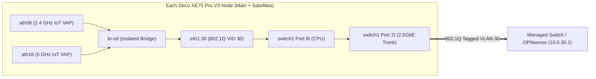

# deco-iot-vlan — True 802.1Q IoT VLAN Tagging & Native Web-UI for TP-Link Deco XE75 Pro V3 (AP Mode)

> **Status:** Active development — 3-node mesh runtime (`Node 1 Main`, `Node 2 Satellite`, `Node 3 Satellite`), end-to-end 802.1Q VLAN 30 tagging (`br-iot` + `eth1.30` + `ath08`/`ath18`), upstream OPNsense DHCP/isolation, automatic watchdog rollback, and native Web-UI status (`Advanced > VLAN Status`) are **live-verified on Firmware 1.5.0 Build 20260603 Rel. 15804**. Durable boot/reload persistence (`codex` lane) is currently being finalized and will be added here upon verification.
>
> **Companion Security Advisory Repository:** [deco-filepush-disclosure](https://github.com/CPlusPlus17/deco-filepush-disclosure) (documents the `:20001 -> :20002` `0xC456 inner_file_push` root file-write primitive used to deploy this without UART).

---

## Why This Project Exists

If you run a **TP-Link Deco XE75 Pro V3** mesh in **Access Point (AP) mode** behind a VLAN-aware router/firewall (OPNsense, pfSense, UniFi, OpenWrt), you hit two stock firmware limitations:
1. **The "IoT Network" toggle in the Deco app does not support 802.1Q VLAN tagging.** All IoT Wi-Fi clients (`2.4 GHz` and `5 GHz`) are bridged directly into `br-lan` (untagged) alongside your trusted LAN.
2. **Even though `/etc/config/iot_wifi` contains `option vlan_enable '0'`, flipping it to `'1'` is a 100% no-op.**

In 2026, isolating untrusted IoT devices onto a dedicated VLAN is a baseline security requirement — artificially withholding or half-shipping that feature on capable Wi-Fi 6E hardware is unacceptable. Worse yet, our audit revealed that **two full years after the 2024 CCS / Black Hat Deco disclosure** (*"Untangling the Knot"*), TP-Link had only bumped the SSH RSA key size on port `20001` from 512-bit to 2048-bit while leaving the underlying `tmpsvr` root handlers (`0xC456` `inner_file_push` root file write, `0x00F0` root file read, and `0xC505` `tty2tcp`) completely unfixed in the June 2026 firmware (`1.5.0`).

Faced with the choice between **turning three working Deco XE75 Pro routers into e-waste and throwing them away, or reverse-engineering the firmware to activate/patch the missing VLAN feature ourselves**, we chose to fix it and release both the security advisory ([deco-filepush-disclosure](https://github.com/CPlusPlus17/deco-filepush-disclosure)) and this VLAN implementation publicly so every Deco owner can immediately secure port `20001` and properly segment their network.

By decrypting and reverse-engineering Firmware `1.5.0 Build 20260603 Rel. 15804` across a 3-unit Deco XE75 Pro V3 mesh, we identified the exact reasons in TP-Link's OpenWrt scripts and built a clean, safety-locked implementation that brings **true 802.1Q VLAN tagging (`br-iot`)** and a **native Web-UI page (`Advanced > VLAN Status`)** to all mesh nodes.

---

## Root Cause: Why Stock Firmware 1.5.0 Doesn't Tag IoT (or AP-Mode Guest) VLANs

Full line-by-line decompilation and script traces are in [`docs/stock-datapath-analysis.md`](docs/stock-datapath-analysis.md). In summary:

| Feature | Stock UCI Config | Why It Fails on Stock Firmware 1.5.0 |
|---|---|---|
| **IoT Network VLAN** (`iot_wifi.iot.vlan_enable`) | `/etc/config/iot_wifi` has `option vlan_enable '0'` | 1. `/etc_ro/init.d/iot_network` has `# . /lib/iot_network/iot_eth.sh` (line 9) and lines 41–69 (`iot_vlan_id`, `switch_iot_config`) **commented out**.<br>2. `/lib/iot_network/iot_eth.sh` was **omitted from the SquashFS rootfs**.<br>3. `/lib/wifi/wificommon.sh` (line 651) hardcodes `uci_set wireless $section network "lan"`, forcing IoT VAPs (`ath08`, `ath18`) onto `br-lan`. |
| **Guest Network VLAN in AP Mode** (`0x4008` `wireless_guest_write`) | `/etc/config/wifi` (`guest.vlan_enable='1'`, `guest.vlan_id='<VID>'`) | `/etc/init.d/guest-eth.sh` (`switch_guest_config`, lines 206–248) checks `if [ "$sysmode" == "Router" ]` before adding external switch ports (`0t 1t 2t 3t 6t`). On a main Deco in **`AP` mode**, it sets `ports '6t'` (CPU port only) and never creates `eth1.<vid>`. |

---

## Architecture of `deco-iot-vlan`



### 1. Dedicated `br-iot` Bridge & Hardware Switch Tagging (`runtime/fleet_runtime.lua`)
Instead of fighting `apsd` / `hyfi` on `br-lan`:
- Creates a dedicated Linux bridge `br-iot` on every mesh node (`Node 1 Main`, `Node 2 Satellite`, `Node 3 Satellite`).
- Creates `eth1.30` (802.1Q VLAN 30 on CPU interface `eth1`) and programs hardware `switch1` VLAN 30 with tagged membership `2t 6t` (Port 2 Ethernet uplink + Port 6 CPU), preserving all untagged main LAN (`eth1.2`/`3`/`4`) and Guest VLAN settings.
- Moves the active IoT VAPs (`ath08` 2.4 GHz and `ath18` 5 GHz) from `br-lan` into `br-iot`.
- Installs explicit IPv4/IPv6 `iptables`/`ip6tables` rules blocking `br-iot` traffic from reaching the Deco's management plane while allowing DHCP/traffic through the tagged trunk to the upstream firewall (`10.0.30.1`).

### 2. Multi-Node Safety & Watchdog Discipline
- **Per-Unit Identity & Route-Cache Preservation:** Each mesh unit has its own pinned SSH host key, `DEV_ID`, MAC baseline, and `/tmp/luci-indexcache` backup (30 entries on the main unit with the native UI route; 29 stock entries on satellites). The main unit's binary route cache is **never** written onto a satellite.
- **Staged Transport Gate (`runtime/offer_probe.lua`):** Before moving any Wi-Fi VAP (`ath08`/`ath18`), the fleet coordinator stages `br-iot` + `eth1.30` on all three units and runs a bounded DHCP-offer probe (`udhcpc -Q`) to verify that every unit's physical switch port can reach the upstream VLAN 30 DHCP server (`10.0.30.1`).
  - *Real-world catch during testing:* This gate immediately caught that two units (`Node 1` & `Node 2` on 2.5GbE ports) received DHCP offers while the third (`Node 3` on a 1GbE switch port) timed out until its switch port trunk configuration was fixed.
- **Independent Kernel-Locked Watchdogs:** Every trial/stage phase arms an independent kernel-locked (`flock`) watchdog on each node that automatically reverts all bridge, VAP, switch, and firewall changes and verifies baseline restoration if not explicitly committed.

### 3. Native Web-UI (`ui/`)
- Adds **Advanced > VLAN Status** directly into the stock Deco Web UI (`https://<deco-ip>/webpages/index.html#guestVlan`) using the stock jQuery `$.su` widget framework and encrypted LuCI proxy.
- Backed by a read-only authenticated LuCI controller (`/admin/vlan_status?form=status`, `ui/overlay/usr/lib/lua/luci/controller/admin/vlan_status.lua`) mounted in RAM via bind mounts without modifying the read-only SquashFS partition.

### 4. Persistence & Reload Lifecycle (`docs/startup-and-lifecycle.md` — *in progress*)
- Stock `/etc/config/firewall` supports `config include` sections loaded by `/lib/firewall/core_init.sh:295-307` at `START45` (`fw_start`), which runs after `/sbin/mount_tpdata` (`START00`, mounting persistent `/tp_data/user_data` UBIFS) and `/sbin/loaduci` (`START10`, decrypting `/tp_data/user_data/user-config` into `/etc/config`).
- `codex` is currently completing the reload/boot lifecycle hooks and full 3-unit persistence verification; those modules will be committed under `persistence/` once all live checks pass.

---

## Repository Layout

```text
deco-iot-vlan/
├── README.md                         # Project overview & architecture
├── docs/
│   ├── stock-datapath-analysis.md    # Decompiled 1.5.0 VLAN/bridge/VAP & NVRAM crypto analysis
│   └── startup-and-lifecycle.md      # Boot order, firewall include audit & reload lifecycle review
├── runtime/
│   ├── fleet_runtime.lua             # Per-node stage / activate / rollback / watchdog engine
│   ├── offer_probe.lua               # Bounded VLAN 30 DHCP offer verifier (pre-activation gate)
│   ├── preflight.lua                 # Per-node hardware/bridge/VAP/uplink baseline collector
│   ├── association_observer.lua      # Read-only station association observer across mesh nodes
│   └── station_parser.lua            # Strict wlanconfig ath08/ath18 station output parser
├── ui/
│   ├── README.txt                    # Native Web-UI patch documentation
│   ├── build_overlay.py              # Builds overlay/ and vlan-status.patch against stock rootfs
│   ├── ui-integration.json           # Menu, model, and label definitions for Advanced > VLAN
│   ├── vlan-status.patch             # Unified diff against stock 1.5.0 /www and /usr/lib/lua
│   └── overlay/                      # New/patched LuCI controller and webpage assets
└── tests/
    ├── test_fleet_runtime.lua        # 41 virtual-kernel safety & rollback test cases
    ├── test_offer_probe.lua          # 34 DHCP offer probe test cases
    ├── test_preflight.lua            # 21 preflight collector test cases
    ├── test_association_observer.lua # 24 station observer test cases
    └── test_station_parser.lua       # Station parser unit tests
```

---

## Running the Offline Test Suite

All runtime modules include offline virtual-kernel test suites that run locally with `luajit` (or Lua 5.1) without contacting any Deco device:

```bash
luajit tests/test_fleet_runtime.lua
luajit tests/test_offer_probe.lua
luajit tests/test_preflight.lua
luajit tests/test_association_observer.lua
luajit tests/test_station_parser.lua
```

---

## Credits

Developed and verified on 2026-10-17 by a 4-agent team (`codex`, `claude`, `gemini`, and `hermes`/Qwen) coordinated by the hardware owner via `agents.comm`. See [deco-filepush-disclosure/TEAM-SUMMARY.md](https://github.com/CPlusPlus17/deco-filepush-disclosure/blob/main/TEAM-SUMMARY.md) for the full multi-agent breakdown.
